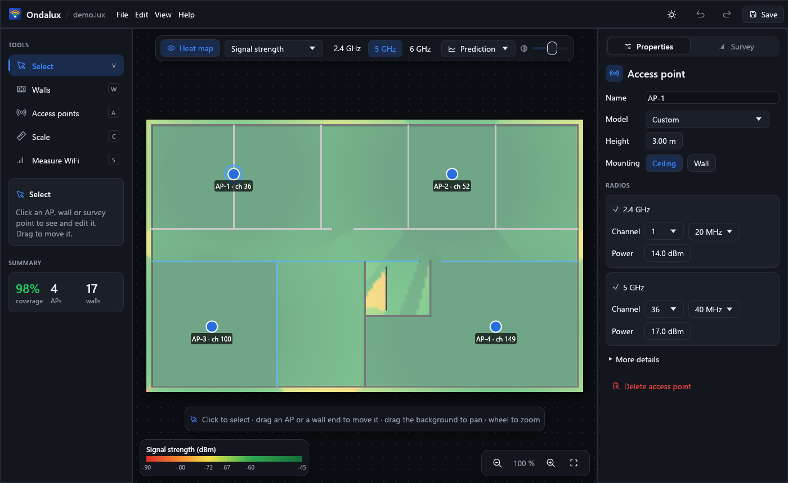
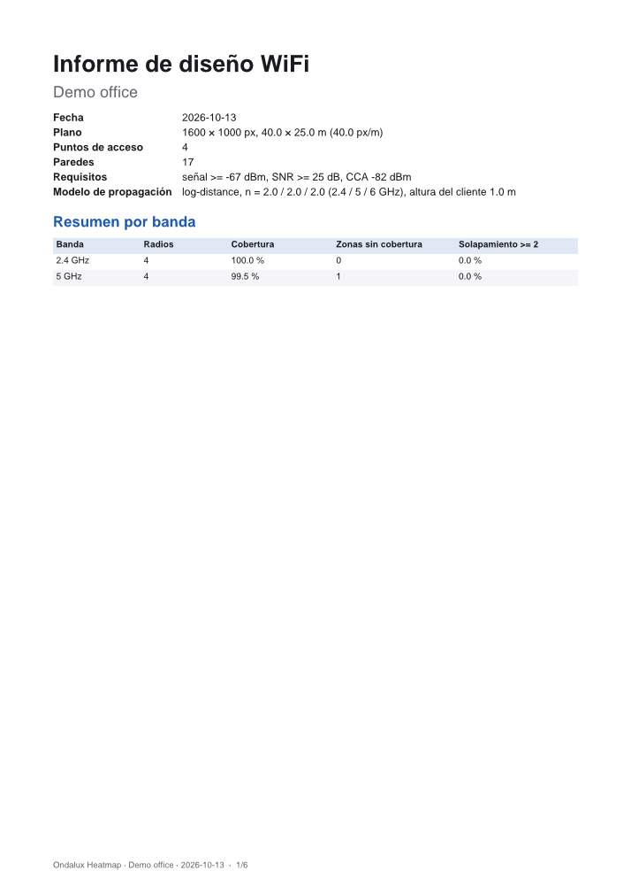
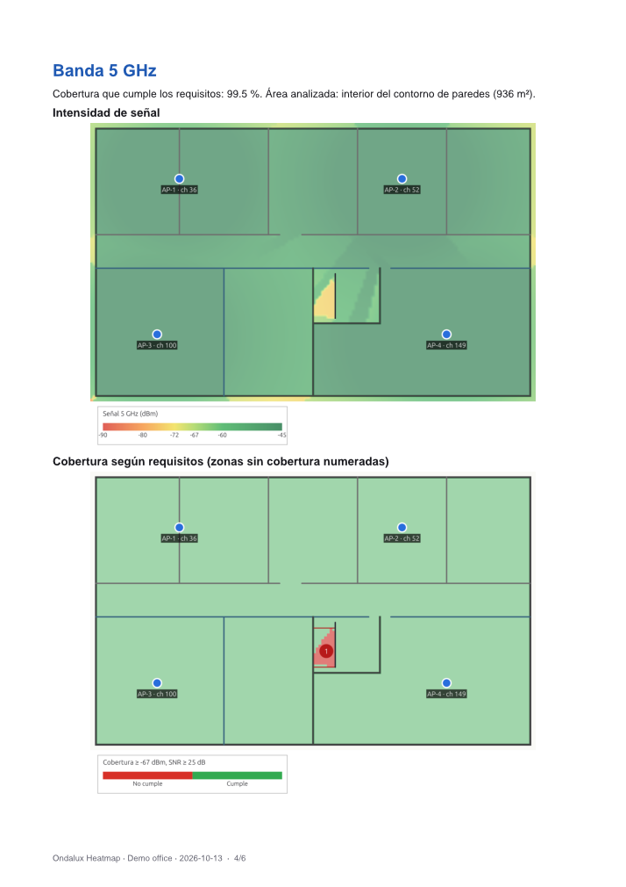

<p align="center"></p>

# Ondalux Heatmap

Open-source desktop app for WiFi network design and site surveys with heat
maps, written in Rust.

**[Website](https://ondaluxheatmap.com)** ·
**[Download for Windows](https://ondaluxheatmap.com/#download)** ·
**[WiFi design guide](https://ondaluxheatmap.com/guide/)** ·
[Contributing](CONTRIBUTING.md) · Support: support@ondaluxheatmap.com

Windows builds are portable (a single `.exe`, no installer). macOS and
Linux build from source; their WiFi scanning backends are not yet tested on
real hardware. See [what works](#status) below.



## Status

| Feature | State |
|---|---|
| Import floor plan: PNG, JPEG, first page of a PDF | ✅ |
| Scale calibration (two points + known distance) | ✅ |
| Draw walls with snapping; material library with editable dB per band (2.4/5/6 GHz) | ✅ |
| Wall thickness in cm (the loss of solid materials scales with it) | ✅ |
| Multi-floor buildings: plan per floor, slab loss, signal between floors, report per floor | ✅ see [docs/rf-models.md](docs/rf-models.md) |
| 3D view: extruded walls over the heat map, floors stacked | ✅ |
| Update notices (reads `ondaluxheatmap.com/version.json` once a day; you choose whether to download) | ✅ can be turned off in Help |
| Automatic wall detection (beta, opt-in) from vector PDF line art or the image, with preview and materials by thickness | ✅ straight, diagonal and curved walls; see [docs/wall-detection.md](docs/wall-detection.md) |
| Place / drag APs; radios with band, channel, width, Tx power, antenna gain; AP height | ✅ |
| AP model catalog by vendor (119 models, 15 vendors, datasheet values with sources) + custom models | ✅ see [docs/ap-catalog.md](docs/ap-catalog.md) |
| AP mounting (ceiling / wall) and pointing direction | ✅ wall APs use a simplified horizontal pattern; ceiling APs are omnidirectional |
| RF engine: FSPL / log-distance, wall ray casting, RSSI, SNR, SINR (co- and adjacent-channel), AP count, channel overlap | ✅ |
| Heat maps: signal, SNR, SINR, AP count, channel overlap, coverage requirement (configurable thresholds) | ✅ |
| Save / open versioned `.lux` projects | ✅ |
| Undo / redo, dark and light themes, keyboard shortcuts | ✅ |
| Survey mode: click your position, record a WiFi scan (SSID, BSSID, RSSI, channel, band, security) | ✅ |
| WiFi scanning: Windows (WLAN API) | ✅ tested on hardware |
| WiFi scanning: macOS (CoreWLAN), Linux (nl80211) | ⚠️ compiles and passes clippy, **not yet run on real hardware**; see [docs/scanning.md](docs/scanning.md) |
| macOS Location Services permission (needed for SSID/BSSID on macOS 14+) | ❌ not implemented |
| Simulated scanner (prediction + random fading) for demos and tests | ✅ clearly labelled as simulated |
| Survey CSV import and export | ✅ |
| Measured heat maps: IDW and ordinary kriging, SSID filter, all six metrics | ✅ |
| Predicted vs. measured: difference map, per-point error, mean/RMSE | ✅ |
| Heat map PNG export (current metric / band / source) | ✅ |
| PDF design report (ES/EN): summary, maps per band, numbered coverage gaps, rule-based recommendations, AP table, survey bias | ✅ see [docs/reports.md](docs/reports.md) |
| AP list CSV export | ✅ |
| Manual entry of AP data (per AP, or as custom catalog models) | ✅ |
| GPU (wgpu) compute | ❌ Not needed so far (CPU + rayon meets the target) |

## Building

Requires Rust 1.82 or newer.

```bash
cargo run --release -p ondalux-app
```

On Linux, egui needs the usual windowing libraries
(`libxkbcommon-dev libwayland-dev libx11-dev libgl1-mesa-dev libgtk-3-dev`
on Debian/Ubuntu).

You can pass a project or a floor plan on the command line:

```bash
cargo run --release -p ondalux-app -- plan.pdf
```

To generate a demo project (synthetic 40 × 25 m office with 4 APs):

```bash
cargo run -p ondalux-io --example demo_project -- demo.lux
```

## Quick guide

1. **File → New from floor plan…** (Ctrl+N) and pick a PNG, JPEG or PDF.
2. **Calibrate (C)**: click two points whose real distance you know (e.g. a
   door or a dimension line) and type the distance in meters.
3. **Wall (W)**: pick a material in the toolbar and click to draw walls.
   Shift snaps to 45°; Esc, right-click or double-click ends the wall. Wall
   ends snap to existing ends.
4. **Access point (A)**: pick the model in the toolbar (or Generic) and click
   to place APs. Radios are filled from the model's datasheet values, on
   rotating channels. Change an AP's model or edit its radios in the right
   panel. **Edit → AP catalog…** browses all models and manages custom ones.
5. **Select (V)**: drag APs or the ends of the selected wall; the heat map
   updates live.
6. Pick the metric (keys **1–6**), band and source (predicted / measured /
   difference) in the toolbar. **Edit →
   Prediction settings** sets the path loss model, client device and coverage
   requirements (presets: voice/video −67 dBm & 25 dB SNR, data −72 dBm &
   20 dB). **Edit → Materials** edits wall losses.

### Field survey

1. Open the **Survey** tab in the right panel and choose the scanner: this
   computer's WiFi adapter, or the simulated scanner for demos.
2. Pick the **Survey (S)** tool, walk to a spot, click your position on the
   plan and stand still until the scan finishes (2–8 s). Repeat every few
   meters. Points can be dragged to fix a misplaced click; select one to see
   every network heard there.
3. Alternatively, **Import CSV…** from another tool (format in
   [docs/survey-csv.md](docs/survey-csv.md)).
4. In **Networks**, keep only your SSIDs. Choose IDW or kriging and the
   maximum distance from a point to interpolate.
5. Set the toolbar source to **Measured** for the real heat map, or
   **Measured − predicted** to see where the design is off. The Survey tab shows
   the mean error and RMSE at the survey points.

On Windows 11 24H2+, scanning requires *Settings → Privacy & security →
Location → Let desktop apps access your location*.

### Reports and exports

**File → Export** saves the heat map on screen as PNG, the AP list or the
survey as CSV, or a PDF design report (Spanish or English) with signal and
coverage maps per band, numbered areas with poor coverage, recommendations
and the AP table. Details and the recommendation rules:
[docs/reports.md](docs/reports.md).

| Report summary | Band section |
|---|---|
|  |  |

| Shortcut | Action |
|---|---|
| Ctrl+N / Ctrl+O / Ctrl+S / Ctrl+Shift+S | New from plan / Open / Save / Save as |
| Ctrl+Z / Ctrl+Y (or Ctrl+Shift+Z) | Undo / Redo |
| V, W, A, C, S | Select, Wall, AP, Calibrate, Survey tools |
| 1–6 | Signal, SNR, SINR, AP count, Channel overlap, Coverage |
| H | Show / hide heat map |
| D | 3D view on / off |
| Page Up / Page Down | Floor above / below |
| F | Fit plan to window |
| Del | Delete selection |
| Esc | Finish wall / back to Select / clear selection |
| Mouse wheel, middle drag | Zoom, pan |

## Architecture

```
crates/
├─ ondalux-core   RF engine and data model. No UI, I/O or OS code.
│   units, geometry (spatial index), channel (802.11 plan), material,
│   ap, propagation (path loss, noise), predict (RSSI + wall ray casting),
│   grid (per-radio layer cache, rayon), metrics, project,
│   survey (data model), interpolate (IDW, kriging), measured,
│   catalog (AP models), colormap, analysis (coverage gaps, findings)
├─ ondalux-io     .lux files, PNG/JPEG/PDF plan import, survey/AP CSV, user catalog
├─ ondalux-scan   WifiScanner trait: Windows / macOS / Linux / simulated
├─ ondalux-report Heat map images and PDF reports (pdf-writer, ab_glyph; pure Rust)
└─ ondalux-app    egui/eframe desktop app (binary `ondalux`)
```

The engine keeps one RSSI grid per radio and only recomputes the radios
whose inputs changed, then re-aggregates the metrics. The app runs this on a
worker thread that always processes the newest request.

- [docs/rf-models.md](docs/rf-models.md): formulas, defaults, limitations
  and benchmark results.
- [docs/project-format.md](docs/project-format.md): `.lux` file format.
- [docs/scanning.md](docs/scanning.md): scanning backends and platform limitations.
- [docs/survey-csv.md](docs/survey-csv.md): survey CSV format.
- [docs/ap-catalog.md](docs/ap-catalog.md): AP model catalog, sources and custom models.
- [docs/reports.md](docs/reports.md): exports, PDF report contents and recommendation rules.

## Development

```bash
cargo fmt --all
cargo clippy --workspace --all-targets -- -D warnings
cargo test --workspace
cargo bench -p ondalux-core
cargo run -p ondalux-scan --example scan   # one real WiFi scan
cargo run --release -p ondalux-report --example report -- demo.lux out es --pages
```

CI (GitHub Actions) runs the same checks on Windows, macOS and Linux.

## Clean-room statement

Ondalux Heatmap is an independent implementation based only on public knowledge
(RF propagation theory, IEEE 802.11 standards, public vendor documentation).
It uses no code, assets, names or trademarks from any commercial product.

## License

Dual-licensed under [MIT](LICENSE-MIT) or [Apache-2.0](LICENSE-APACHE), at
your option.
