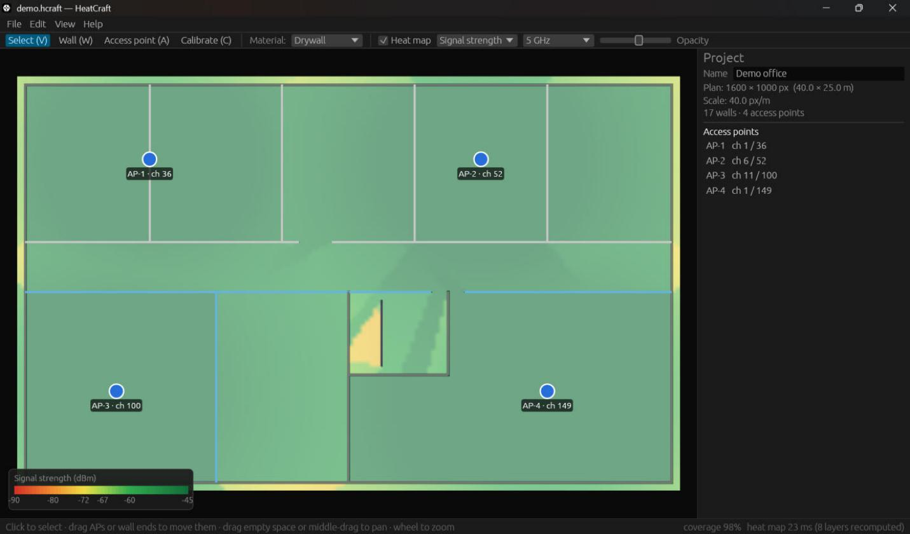

# HeatCraft (provisional name)

Open source desktop tool for WiFi network design with heat maps, written in
Rust. Windows, macOS and Linux.

**Status: Phase 1 (predictive design) complete. Phases 2 (field survey) and 3
(reports) are not started.** See [what works](#status) below.



## Status

| Feature | State |
|---|---|
| Import floor plan: PNG, JPEG, first page of a PDF | ✅ |
| Scale calibration (two points + known distance) | ✅ |
| Draw walls with snapping; material library with editable dB per band (2.4/5/6 GHz) | ✅ |
| Place / drag APs; radios with band, channel, width, Tx power, antenna gain; AP height | ✅ |
| AP orientation / directional antennas | ⚠️ **STUB**: stored and editable, ignored by the engine (omni only) |
| RF engine: FSPL / log-distance, wall ray casting, RSSI, SNR, SINR (co- and adjacent-channel), AP count, channel overlap | ✅ |
| Heat maps: signal, SNR, SINR, AP count, channel overlap, coverage requirement (configurable thresholds) | ✅ |
| Save / open versioned `.hcraft` projects | ✅ |
| Undo / redo, dark and light themes, keyboard shortcuts | ✅ |
| Field survey, WiFi scanning (`heatcraft-scan`) | ⚠️ **STUB**: Phase 2 |
| CSV import, IDW/kriging interpolation, predicted vs. measured | ❌ Phase 2 |
| PNG/PDF reports, CSV export | ❌ Phase 3 |
| GPU (wgpu) compute | ❌ Not needed so far (CPU + rayon meets the target) |

## Building

Requires Rust 1.82 or newer.

```bash
cargo run --release -p heatcraft-app
```

On Linux, egui needs the usual windowing libraries
(`libxkbcommon-dev libwayland-dev libx11-dev libgl1-mesa-dev libgtk-3-dev`
on Debian/Ubuntu).

You can pass a project or a floor plan on the command line:

```bash
cargo run --release -p heatcraft-app -- plan.pdf
```

To generate a demo project (synthetic 40 × 25 m office with 4 APs):

```bash
cargo run -p heatcraft-io --example demo_project -- demo.hcraft
```

## Quick guide

1. **File → New from floor plan…** (Ctrl+N) and pick a PNG, JPEG or PDF.
2. **Calibrate (C)**: click two points whose real distance you know (e.g. a
   door or a dimension line) and type the distance in meters.
3. **Wall (W)**: pick a material in the toolbar and click to draw walls.
   Shift snaps to 45°; Esc, right-click or double-click ends the wall. Wall
   ends snap to existing ends.
4. **Access point (A)**: click to place APs. Each new AP gets a 2.4 GHz and
   a 5 GHz radio on rotating channels (plus a disabled 6 GHz radio). Edit
   them in the right panel.
5. **Select (V)**: drag APs or the ends of the selected wall; the heat map
   updates live.
6. Pick the metric (keys **1–6**) and band in the toolbar. **Edit →
   Prediction settings** sets the path loss model, client device and coverage
   requirements (presets: voice/video −67 dBm & 25 dB SNR, data −72 dBm &
   20 dB). **Edit → Materials** edits wall losses.

| Shortcut | Action |
|---|---|
| Ctrl+N / Ctrl+O / Ctrl+S / Ctrl+Shift+S | New from plan / Open / Save / Save as |
| Ctrl+Z / Ctrl+Y (or Ctrl+Shift+Z) | Undo / Redo |
| V, W, A, C | Select, Wall, AP, Calibrate tools |
| 1–6 | Signal, SNR, SINR, AP count, Channel overlap, Coverage |
| H | Show / hide heat map |
| F | Fit plan to window |
| Del | Delete selection |
| Esc | Finish wall / back to Select / clear selection |
| Mouse wheel, middle drag | Zoom, pan |

## Architecture

```
crates/
├─ heatcraft-core   RF engine and data model. No UI, I/O or OS code.
│   units, geometry (spatial index), channel (802.11 plan), material,
│   ap, propagation (path loss, noise), predict (RSSI + wall ray casting),
│   grid (per-radio layer cache, rayon), metrics, project
├─ heatcraft-io     .hcraft files, PNG/JPEG/PDF plan import (pure Rust)
├─ heatcraft-scan   WiFi scanning backends (STUB, Phase 2)
└─ heatcraft-app    egui/eframe desktop app (binary `heatcraft`)
```

The engine keeps one RSSI grid per radio and only recomputes the radios
whose inputs changed, then re-aggregates the metrics. The app runs this on a
worker thread that always processes the newest request.

- [docs/rf-models.md](docs/rf-models.md): formulas, defaults, limitations
  and benchmark results.
- [docs/project-format.md](docs/project-format.md): `.hcraft` file format.

## Development

```bash
cargo fmt --all
cargo clippy --workspace --all-targets -- -D warnings
cargo test --workspace
cargo bench -p heatcraft-core
```

CI (GitHub Actions) runs the same checks on Windows, macOS and Linux.

## Clean-room statement

HeatCraft is an independent implementation based only on public knowledge
(RF propagation theory, IEEE 802.11 standards, public vendor documentation).
It uses no code, assets, names or trademarks from any commercial product.

## License

Dual-licensed under [MIT](LICENSE-MIT) or [Apache-2.0](LICENSE-APACHE), at
your option.
